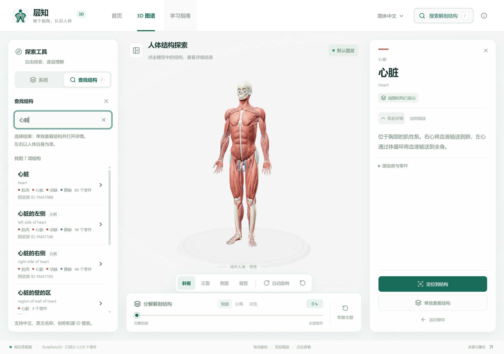
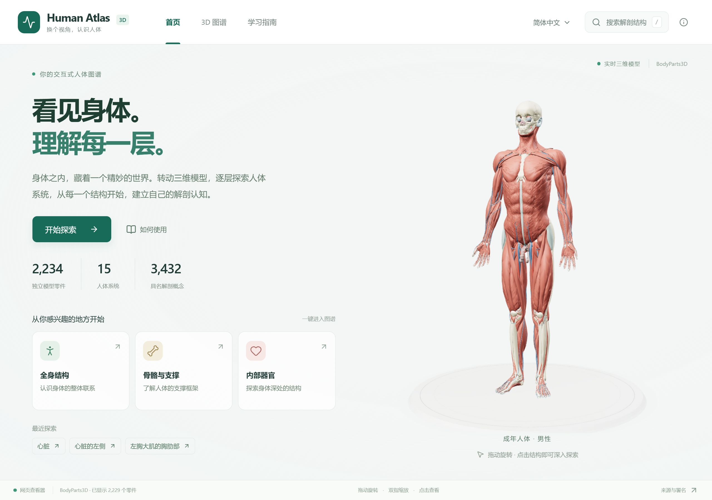
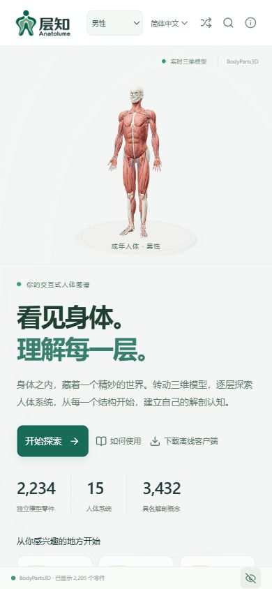

<div align="center">


# 层知 · Anatolume

**看见身体，理解每一层。**

三维人体图谱 · 中英双语 · 网页探索与离线桌面客户端

*3D Anatomy Explorer · Explore the body, layer by layer.*

[](#核心体验)
[](#开始使用)
[](LICENSE)
[](public/ATTRIBUTION.md)

<p align="center">
  <a href="https://isunky.github.io/Anatolume/" target="_blank" rel="noopener noreferrer"></a>
  &nbsp;&nbsp;
  <a href="https://anatolume.sunky.net/" target="_blank" rel="noopener noreferrer"></a>
</p>

**[下载客户端](https://github.com/isunky/Anatolume/releases) · [开发文档](client/README.md)**

[界面预览](#界面预览) · [核心体验](#核心体验) · [开始使用](#开始使用) · [开发与构建](#开发与构建) · [开源致谢](#开源致谢)

</div>

层知将人体结构变成可以旋转、分层、拆解和搜索的学习空间。从全身关系出发，探索骨骼、肌肉与器官；也可以直接找到一个结构，单独观察并阅读说明。无需账号，桌面客户端随包提供模型，可离线探索。

| 模型零件 | 人体系统 | 解剖概念 | 界面语言 |
| :---: | :---: | :---: | :---: |
| **2,234** | **15** | **3,432** | **中文 / English** |

## 界面预览

搜索结构、调整图层、观察模型和阅读说明，在同一个探索界面完成。选中心脏等内部结构后，可单独查看，也可恢复周围结构，理解它们的位置关系。

[](docs/screenshots/explorer.jpg)

<details>
<summary><strong>查看更多界面</strong> · 主页、结构详情与手机视图</summary>

### 主页

从全身、骨骼、器官三个入口开始，或继续查看最近探索的结构。

[](docs/screenshots/home.jpg)

### 结构详情与手机视图

<p align="center">
  <a href="docs/screenshots/structure-detail.jpg"></a>
  &nbsp;
  <a href="docs/screenshots/home-mobile.jpg"></a>
</p>

截图以两倍尺寸采集，点击图片可查看原图。桌面截图为 2560 × 1800，手机主页对应 390 × 844 视口。

</details>

<sub>截图来自更名后的真实应用界面。在线演示与已发布安装包的界面以各自版本为准。</sub>

## 核心体验

| 功能 | 可以做什么 |
| --- | --- |
| **逐层看清身体** | 在全身、骨骼与器官视图间切换，显示、隐藏或仅看某个人体系统。 |
| **从任意角度观察** | 旋转、缩放并点击模型；快速切换正面、侧面、背面与斜视。 |
| **中英双语查找** | 搜索中文、英文、俗称或源 ID，例如“心脏”“大腿骨”“FMA7088”。 |
| **聚焦一个结构** | 单独观察目标，再恢复周围组织，对照位置与关系。 |
| **拆开理解层次** | 从完整人体平滑过渡到分离视图与零件总览。 |
| **随时继续探索** | 本机保存语言偏好和最近查看的结构，支持网页与离线桌面使用。 |

## 开始使用

**直接探索：** 打开 [在线演示](https://isunky.github.io/Anatolume/)，选择入口，点击模型或搜索一个结构，再试试旋转、分层与拆解。

**离线使用：** 前往 [下载页](https://github.com/isunky/Anatolume/releases)，选择对应平台的安装包。

| 平台 | 使用方式 |
| --- | --- |
| **Windows x64** | 运行安装包；也可下载便携版，解压后启动。 |
| **macOS 11+** | 下载通用 DMG，拖入 Applications；支持 Intel 与 Apple Silicon。 |
| **网页** | 浏览器直接访问；Web ZIP 可用于自行部署。 |
| **Android** | 暂未提供安装包，可使用网页版。 |

> 应用与仓库现采用「层知 · Anatolume」。新版本发布包使用 Anatolume 文件名，历史版本保留原名称。

<details>
<summary><strong>安装说明与发布文件</strong></summary>

| 文件 | 说明 |
| --- | --- |
| `Anatolume_<版本号>_x64-setup.exe` | Windows 安装版，按当前用户安装。 |
| `Anatolume_<版本号>_Windows-x64-portable.zip` | Windows 便携版，解压运行 `Anatolume.exe`。 |
| `Anatolume_<版本号>_macOS-universal.dmg` | macOS 通用安装包。 |
| `Anatolume_<版本号>_Web.zip` | 完整静态页面与模型，部署后通过 HTTP/HTTPS 访问。 |

- **Windows：** 需要 WebView2。已安装运行时时可离线安装；缺少运行时时，安装程序会联网下载。便携版需要事先安装运行时。安装后从开始菜单启动 **Anatolume**。
- **macOS：** 当前使用 ad-hoc 签名，尚未经过 Apple 公证；首次打开可能需要在“系统设置 → 隐私与安全性”中允许。
- **安装提示：** Windows 测试版尚未签名，可能显示未知发布者提示。每个自动发布的版本提供 `SHA256SUMS` 和 `BUILD-REPORT.md`。
- **离线范围：** 桌面模型随包提供；查看外部数据来源和参考资料需要联网。语言偏好与最近探索记录保存在本机。

</details>

<details>
<summary><strong>操作与快捷键</strong></summary>

| 操作 | 方法 |
| --- | --- |
| 旋转 / 缩放 | 拖动模型区域 / 鼠标滚轮或双指缩放。 |
| 查看结构 | 点击模型，或选择搜索结果。 |
| 聚焦搜索 | 点击搜索入口，或在非输入状态按 `/`。 |
| 选择搜索结果 | `↑` / `↓` 移动高亮，`Enter` 选择。 |
| 退出搜索 | 按 `Esc`，或点击“关闭搜索”。 |
| 对照周围组织 | 选中结构后点击“显示周围结构”。 |
| 回到默认视图 | 点击底部“恢复全部”。 |

左右均以**人体自身**为准。更多操作说明见 [客户端文档](client/README.md)。

</details>

<details>
<summary><strong>常见问题</strong></summary>

| 情况 | 排查方法 |
| --- | --- |
| 客户端窗口空白 | 检查 WebView2 与显卡驱动，关闭后重新启动。 |
| 模型加载失败 | 网页检查网络与模型资源；客户端尝试重新启动或重新安装。 |
| 看不到内部器官 | 搜索并单独查看目标，或关闭遮挡它的外层系统。 |
| 卸载 Windows 客户端 | 使用 Windows 设置中的“已安装的应用”。 |

</details>

## 开发与构建

前端使用 React、TypeScript 与 Three.js，桌面端使用 Tauri。网页与客户端共享界面和三维渲染逻辑，仓库已包含可用模型。

[客户端开发文档](client/README.md) · [代码结构与 CI](docs/PROJECT_STRUCTURE.md) · [版本与发布指南](docs/RELEASE.md) · [CI 状态](https://github.com/isunky/Anatolume/actions/workflows/ci.yml)

<details>
<summary><strong>快速开始</strong> · 本地运行与网页构建</summary>

需要 **Node.js 22.18 或更新版本**。

```sh
git clone https://github.com/isunky/Anatolume.git
cd Anatolume
npm ci
npm run dev
```

打开 <http://127.0.0.1:3016/>。开发服务器默认仅绑定本机。

```sh
npm run build
```

静态产物位于 `dist/`，支持根目录与子目录部署。Web ZIP 解压后需通过 HTTP/HTTPS 服务器访问。GitHub Pages 地址为 <https://isunky.github.io/Anatolume/>；Vercel 使用 Vite、`npm ci`、`npm run build` 和 `dist` 输出目录，配置见 [`vercel.json`](vercel.json)。

</details>

<details>
<summary><strong>Cloudflare Pages</strong> · 连接 GitHub 自动构建</summary>

在 Cloudflare Pages 连接 `isunky/Anatolume`，生产分支选择 `main`：

| 设置 | 值 |
| --- | --- |
| 框架 | React (Vite) |
| 根目录 | 留空，使用仓库根目录 |
| 构建命令 | `npm ci && npm run build:pages` |
| 输出目录 | `dist` |
| 环境变量 | `SKIP_DEPENDENCY_INSTALL=1`，生产与预览均设置 |
| Node | `.node-version` 已指定 `24` |

专用构建验证压缩模型和 Pages 文件限制，生成版本与源码记录。后续推送自动构建，详见 [Cloudflare Pages 配置指南](docs/CLOUDFLARE_PAGES.md)。

</details>

<details>
<summary><strong>桌面构建、验证与发布</strong></summary>

Windows 构建还需要 **Rust MSVC 工具链、Visual Studio C++ Build Tools、Windows SDK 与 WebView2**。

| 命令 | 用途 |
| --- | --- |
| `npm run client:dev` | 启动桌面开发模式。 |
| `npm run build:client` | 构建客户端前端，输出到 `dist-client/`。 |
| `npm run client:build` | 构建 Windows x64 NSIS 安装包。 |
| `npm run client:build:mac` | 在 macOS 构建 Intel / Apple Silicon 通用 DMG。 |
| `npm run ci:check` | 执行类型、语言、模型、交互、前端构建与客户端资源检查。 |
| `npm run validate:release` | 检查版本递增、一致性、重试和安装包校验。 |

Windows 安装包输出到 `src-tauri/target/x86_64-pc-windows-msvc/release/bundle/nsis/`。第一次 Rust 构建可能需要数分钟。

浏览器交互已覆盖桌面及多种手机视口；真实手机性能与多指硬件操作仍需设备验证。

GitHub Actions 将 CI 与发布分开：提交和 PR 自动运行测试及 Web、Pages、桌面前端构建；需要发布时，手动启动版本发布工作流并选择 `patch / minor / major`，自动完成版本同步、Windows / macOS / Web 构建、GitHub Release 与 Pages 部署。Release notes 会摘要列出本次变更。`0.x` 为测试版，主版本达到 `1` 后为正式版。完整流程见 [发布指南](docs/RELEASE.md)。

</details>

<details>
<summary><strong>项目结构与模型处理</strong></summary>

| 目录 | 内容 |
| --- | --- |
| `app/` | 页面交互、三维场景、数据与渲染模块。 |
| `client/` | 双语术语、学习说明与平台桥接。 |
| `components/ui/` | 可复用界面组件。 |
| `public/models/` | 模型清单、二进制与压缩资源。 |
| `src-tauri/` | 原生窗口、权限与桌面打包。 |
| `scripts/` | 模型转换、压缩、验证与发布脚本。 |
| `docs/` | 架构文档与界面截图。 |

渲染采用批次绘制与按需帧调度。结构的显隐、选择和分解由 GPU 数据控制，完全隐藏的批次跳过绘制。更多实现说明见 [代码结构与 CI](docs/PROJECT_STRUCTURE.md)。

普通运行与构建**无需重新转换模型**。修改数据处理流程时，获取官方 BodyParts3D OBJ 与英文元数据，按脚本参数依次运行 [`convert-anatomy.py`](scripts/convert-anatomy.py)、[`optimize-anatomy.mjs`](scripts/optimize-anatomy.mjs) 和 [`compress-models.mjs`](scripts/compress-models.mjs)，随后执行 `npm run ci:check`。

</details>

## 来源与许可

| 内容 | 许可与说明 |
| --- | --- |
| **应用代码** | [MIT License](LICENSE)，保留原作者版权与许可声明。 |
| **解剖模型与源数据** | BodyParts3D 4.0，采用 **CC BY 4.0**，保留署名及改编说明。 |
| **第三方依赖** | 遵循各自许可证。 |

> 本项目用于解剖学习与探索，不用于诊断、手术规划或临床决策。模型为成年男性参考解剖，不能代表所有结构或个体差异；中文术语与新增学习说明尚未经医学专家审校。

<details>
<summary><strong>数据范围与术语说明</strong></summary>

- **数据范围：** 2,234 个独立网格、15 个人体系统、3,432 个具名解剖概念；一个概念可包含多个零件。
- **模型处理：** 几何经过简化，包含 2,288,268 个三角形，压缩几何约 33 MB；每结构相对误差上限为 0.2%，保留全部源网格的对应表示。
- **中文术语：** 覆盖 5,090 个唯一源名称，为规则生成并补充常见词组的待审校草稿。保留英文原名和源 ID 用于核对，结构说明区分具体器官解释与一般系统概述。
- **完整记录：** 数据来源、许可链接与改编记录见 [署名与授权说明](public/ATTRIBUTION.md)；术语维护方式见 [中文术语审校](client/README.md#中文术语审校)。

</details>

欢迎通过 [Issues](https://github.com/isunky/Anatolume/issues) 或 [Pull requests](https://github.com/isunky/Anatolume/pulls) 改进项目。交互反馈请附复现步骤与运行环境；术语修正请附源 ID、建议名称及参考来源。代码提交前运行 `npm run ci:check`，涉及 Rust 时检查格式，界面改动同步更新截图。

<details>
<summary><strong>English overview</strong></summary>

**Anatolume (层知)** is an interactive 3D anatomy explorer. Rotate the body, reveal its layers, search structures in Chinese or English, and isolate a part to understand its shape and surroundings.

Explore **2,234 selectable meshes**, **15 anatomical systems**, and **3,432 named concepts** from the BodyParts3D adult male reference anatomy. Use the web app or download an offline desktop client for Windows x64 and macOS Intel / Apple Silicon. Language preferences and recently explored structures are saved locally.

[Try online](https://isunky.github.io/Anatolume/) · [Download](https://github.com/isunky/Anatolume/releases) · [Developer guide](client/README.md)

The application is named **层知** in Chinese and **Anatolume** in English. The repository and new release packages use Anatolume; historical releases retain their original names.

Based on [Human Atlas by ashemag](https://github.com/ashemag/human-atlas). Application code is licensed under [MIT](LICENSE); BodyParts3D data is licensed under **CC BY 4.0**, with credits and adaptations in [ATTRIBUTION.md](public/ATTRIBUTION.md). Chinese terminology and added learning content have not been professionally reviewed. This project is for education and exploration, not clinical use.

For local development, use Node.js **22.18+**, run `npm ci` and `npm run dev`, then open <http://127.0.0.1:3016/>. Run `npm run ci:check` for validation.

</details>

## 开源致谢

**层知是在开源项目与开放解剖数据的基础上继续开发的应用。感谢原作者和社区提供的代码、模型与工具，让人体结构能够被更多人观察和理解。**

### 原始项目 · Human Atlas

特别感谢 **[ashemag](https://github.com/ashemag)** 开源的 **[Human Atlas](https://github.com/ashemag/human-atlas)**，为本项目提供了三维人体探索的代码基础。层知在此基础上继续完善中英双语体验、交互界面与离线桌面客户端。原项目采用 MIT License，本仓库保留原作者的版权与许可声明，详见 [LICENSE](LICENSE)。

### 开放数据 · BodyParts3D

特别感谢 **The Database Center for Life Science** 提供的 **[BodyParts3D](https://dbarchive.biosciencedbc.jp/en/bodyparts3d/download.html)**。本应用使用的解剖模型、英文名称及结构关系来自这一开放数据库；这些数据是三维图谱的核心基础。

> BodyParts3D, © The Database Center for Life Science licensed under CC Attribution 4.0 International.

数据采用 [CC BY 4.0](https://creativecommons.org/licenses/by/4.0/) 授权。完整来源、署名与改编说明见 [ATTRIBUTION.md](public/ATTRIBUTION.md)。

### 开源工具与社区

感谢 **[React](https://react.dev/)**、**[Three.js](https://threejs.org/)**、**[Tauri](https://tauri.app/)**、**[Vite](https://vite.dev/)**、**[Tailwind CSS](https://tailwindcss.com/)**、**[Base UI](https://base-ui.com/)**、**[Lucide](https://lucide.dev/)** 与 **[meshoptimizer](https://github.com/zeux/meshoptimizer)** 等开源项目，以及参与维护、反馈和改进的贡献者。
