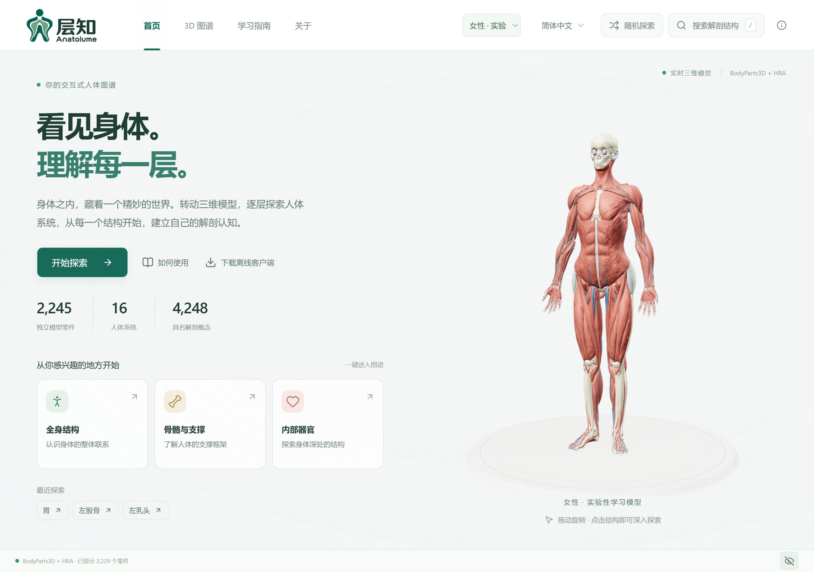
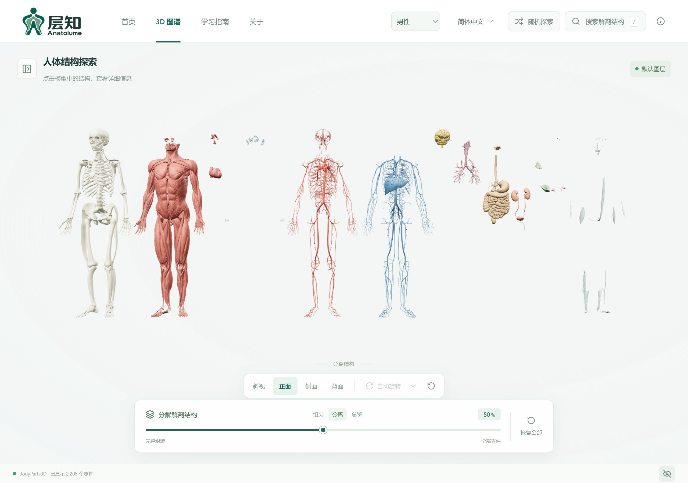

<div align="center">


# 层知 · Anatolume

**看见身体，理解每一层。**

三维人体图谱 · 中英双语 · 网页探索与离线客户端

**简体中文** · [English](README.en.md)

[](#开始使用)
[](https://github.com/isunky/Anatolume/actions/workflows/ci.yml)
[](LICENSE)
[](public/ATTRIBUTION.md)

<p align="center">
  <a href="https://isunky.github.io/Anatolume/" target="_blank" rel="noopener noreferrer"></a>
  &nbsp;&nbsp;
  <a href="https://anatolume.sunky.net/" target="_blank" rel="noopener noreferrer"></a>
</p>

[**下载离线客户端**](https://github.com/isunky/Anatolume/releases) · [使用指南](#开始使用) · [开发文档](#文档导航)

[界面预览](#界面预览) · [核心功能](#核心功能) · [模型与许可](#模型与许可) · [参与贡献](#参与贡献) · [开源致谢](#开源致谢)

</div>

层知将人体结构变成可以旋转、分层、拆解和搜索的学习空间。从全身关系出发探索骨骼、肌肉与器官，也可以直接找到一个结构，单独观察并阅读介绍。无需账号；网页打开即用，桌面客户端随包提供男女两套模型，支持离线探索。

## 界面预览

系统列表、三维观察和结构介绍集中在同一个探索界面。展开系统可筛选下级结构并控制显隐，选中器官后可在单独观察与周围视图之间切换。

[](docs/screenshots/explorer.jpg)

<details>
<summary><strong>更多真实界面</strong> · 首页、女性模型、结构详情、分离模式与手机端</summary>

### 首页

从全身、骨骼、器官开始探索，也可通过右上角“随机探索”发现一个完整器官。

[](docs/screenshots/home.jpg)

### 女性学习模型

页眉切换模型，探索乳腺及女性生殖结构。

[](docs/screenshots/female.jpg)

### 结构详情

单独查看目标，或平滑定位回周围视图，理解结构的位置关系。

[](docs/screenshots/structure-detail.jpg)

### 系统分离

主要系统按实际宽度紧凑排开，保留内部关系；继续拖动滑条进入零件总览。

[](docs/screenshots/separated.jpg)

### 手机端

<p align="center">
  <a href="docs/screenshots/home-mobile.jpg"></a>
</p>

</details>

<sub>真实应用截图，采集于 2026-10-12。桌面原图 2560 × 1800，手机 390 × 844；保留浏览器原始 JPEG 输出，点击可查看高清原图。在线站点和安装包以各自版本为准。</sub>

## 核心功能

| 探索方式 | 体验 |
| --- | --- |
| **男女模型** | 页眉切换男性参考模型与女性学习模型，分别保存最近浏览记录。 |
| **分层浏览** | 全身、骨骼、器官视图；展开系统、筛选下级结构、逐项显隐或仅看某个系统。 |
| **双语搜索** | 使用中文、英文、俗称或源 ID 查找，如“心脏”“大腿骨”“FMA7088”。 |
| **结构聚焦** | 单独观察并阅读介绍；“定位到结构”平滑返回周围视图并高亮目标。 |
| **镜头与旋转** | 平滑切换斜视、正面、侧面与背面；自动旋转支持方向和连续速度调节。 |
| **随机探索** | 右上角入口随机选择完整器官并聚焦；详情中“再换一个”可继续探索。 |
| **隐私模式** | 默认视图与随机探索隐藏敏感结构；主动搜索或从列表打开系统、部件仍可查看。 |
| **拆解观察** | 从完整人体过渡到紧凑系统分离，再进入零件总览。 |
| **离线与更新** | 桌面模型随包提供；本机保存偏好与记录，客户端支持检查并安装新版。 |

## 开始使用

**在线：** 打开 [GitHub Pages](https://isunky.github.io/Anatolume/) 或 [Cloudflare Pages](https://anatolume.sunky.net/)，选择模型和探索入口。

**离线：** 前往 [GitHub Releases](https://github.com/isunky/Anatolume/releases)，选择适合的发布文件。

| 版本 | 文件 | 使用方式 |
| --- | --- | --- |
| Windows x64 安装版 | `Anatolume_<版本号>_x64-setup.exe` | 安装后从开始菜单启动。 |
| Windows x64 便携版 | `Anatolume_<版本号>_Windows-x64-portable.zip` | 解压后运行 `Anatolume.exe`。 |
| macOS 通用版 | `Anatolume_<版本号>_macOS-universal.dmg` | macOS 11+，支持 Intel 与 Apple Silicon。 |
| Web 部署包 | `Anatolume_<版本号>_Web.zip` | 包含页面与模型，通过 HTTP/HTTPS 部署。 |

手机可直接使用网页版，目前没有 Android 安装包。历史版本可能使用应用更名前的文件名。

<details>
<summary><strong>安装、离线与自动更新说明</strong></summary>

- **Windows：** 需要 WebView2。安装程序在缺少运行时时联网下载；便携版需预先安装运行时。当前程序没有 Authenticode 签名，系统可能提示未知发布者。
- **macOS：** 建议从源码自行构建。自动生成的 DMG 使用 ad-hoc 签名，未经 Apple 公证；首次启动可能需要在系统安全设置中允许。
- **离线范围：** 客户端内含两套模型；外部来源、参考资料和更新下载需要联网。语言、模型偏好与最近浏览记录保存在本机。
- **自动更新：** 启动检查正式版，在“关于与致谢 → 应用更新”可查看更新内容、手动检查、下载并安装。离线或检查失败不影响探索。
- **更新包：** 安装版、便携版与 macOS 使用对应的签名更新包；应用内签名不替代操作系统代码签名。旧客户端需先手动安装首个支持更新的版本。
- **校验：** 发布提供 `SHA256SUMS` 和 `BUILD-REPORT.md`。完整更新与构建说明见 [发布指南](docs/RELEASE.md)。

</details>

<details>
<summary><strong>操作与快捷键</strong></summary>

| 操作 | 方法 |
| --- | --- |
| 旋转／缩放 | 拖动模型／滚轮或双指缩放。 |
| 查看结构 | 点击模型、搜索结果或列表中的结构。 |
| 搜索 | 点击搜索入口；非输入状态按 `/`。 |
| 选择搜索结果 | `↑`／`↓` 移动，`Enter` 选择，`Esc` 退出。 |
| 对照位置 | “显示周围结构”；“定位到结构”平滑定位并高亮目标。 |
| 继续随机探索 | 右上角“随机探索”，或详情中的“再换一个”。 |
| 自动旋转设置 | 打开按钮旁下拉框，选择方向并拖动速度滑条；100% 为最高速度。 |
| 隐私设置 | 点击底部隐私图标进入设置；鼠标悬浮查看当前状态解释。 |
| 恢复默认 | 点击底部“恢复全部”。 |

左右均以**人体自身**为准。更多说明见 [客户端文档](client/README.md)。

</details>

<details>
<summary><strong>常见问题</strong></summary>

| 情况 | 排查方法 |
| --- | --- |
| 客户端窗口空白 | 检查 WebView2 与显卡驱动，重新启动。 |
| 模型加载失败 | 网页检查网络和资源；客户端尝试重新启动或安装。 |
| 看不到内部器官 | 搜索后单独查看，或隐藏遮挡的外层系统。 |
| 卸载 Windows 客户端 | 在系统“已安装的应用”中卸载。 |

</details>

## 模型与许可

| 模型 | 独立网格 | 系统／图层 | 具名概念 |
| --- | ---: | ---: | ---: |
| 男性参考模型 | 2,234 | 15 | 3,432 |
| 女性实验性学习模型 | 2,245 | 16 | 4,248 |

女性模型基于 BodyParts3D 与 HRA 数据，经 Human Atlas Enhanced 改编；比例和位置为估算，尚未经独立解剖审校。范围与来源见 [女性模型指南](docs/FEMALE_MODEL.md)。

| 内容 | 许可 |
| --- | --- |
| 应用代码 | [MIT](LICENSE)，保留原作者版权与许可声明。 |
| 解剖模型与源数据 | **CC BY 4.0**，保留 BodyParts3D、HRA 的原作者、来源与改编记录，详见 [ATTRIBUTION.md](public/ATTRIBUTION.md)。 |
| 第三方依赖 | 遵循各自许可证。 |

> 用于解剖学习与探索，不用于诊断、手术规划或临床决策。模型不能代表所有结构与个体差异；中文术语和新增学习说明尚未经医学专家审校。

<details>
<summary><strong>数据范围与处理记录</strong></summary>

- 一个概念可包含多个模型零件，概念数量不等于可独立显示的网格数量。
- 女性模型包含女性生殖器官与独立乳房组织图层，仍缺少女性外部皮肤、生殖器外表面及已验证的女性尿道／盆底替代结构。
- 男性含 2,288,268 个三角形，压缩几何约 33 MB；女性含 2,437,148 个三角形，约 35 MB。模型处理采用每结构 0.2% 相对误差上限，女性保留上游几何、改编及校验记录。
- 中文术语覆盖两套模型的 5,172 个唯一源名称，属于规则生成并补充常见词组的待审校草稿；保留英文原名与源 ID 供核对。
- 结构说明区分具体器官解释与一般系统概述；维护方式见 [中文术语审校](client/README.md#中文术语审校)。

</details>

## 开发与构建

React · TypeScript · Three.js · Tauri · Vite。网页和客户端共享交互与渲染逻辑，仓库已包含模型，普通运行无需重新转换数据。

需要 **Node.js 22.18+**；仓库 `.node-version` 指定 Node 24。

```sh
git clone https://github.com/isunky/Anatolume.git
cd Anatolume
npm ci
npm run dev
```

开发地址：<http://127.0.0.1:3016/>，默认仅绑定本机。

| 命令 | 用途 |
| --- | --- |
| `npm run build` | Web 构建，输出 `dist/`。 |
| `npm run build:pages` | Cloudflare Pages 专用构建及资源验证。 |
| `npm run build:client` | 客户端前端，输出 `dist-client/`。 |
| `npm run client:dev` | 启动桌面开发模式。 |
| `npm run client:build` | Windows x64 NSIS 安装包。 |
| `npm run client:build:mac` | 在 macOS 构建通用 DMG。 |
| `npm run ci:check` | 类型、双语、模型、交互及构建检查。 |
| `npm run validate:release` | 版本与发布流程校验。 |

Windows 原生构建需要 Rust MSVC、Visual Studio C++ Build Tools、Windows SDK 与 WebView2。本地不生成签名更新包时，使用 `npm run client:build -- --config src-tauri/tauri.local.conf.json`；macOS 使用同样配置参数。详情见 [发布签名说明](docs/RELEASE.md#发布签名密钥)。

### 部署与发布

- **静态部署：** `dist/` 支持根目录和子目录；Web ZIP 需通过 HTTP/HTTPS 服务访问。Vercel 配置见 [vercel.json](vercel.json)。
- **Cloudflare Pages：** 连接仓库的 `main`，构建命令 `npm ci && npm run build:pages`，输出 `dist`，环境变量 `SKIP_DEPENDENCY_INSTALL=1`。详见 [配置指南](docs/CLOUDFLARE_PAGES.md)。
- **CI：** 提交／PR 自动运行检查以及 Web、Pages、客户端前端构建，不修改版本、不创建 Release。
- **手动发布：** 选择 `patch / minor / major`，自动同步版本、构建全部平台、签名更新包、发布 Release 并部署 GitHub Pages。更新说明直接摘要本次变更；`0.x` 标为预发布，`1.x` 起为正式版。

## 文档导航

| 文档 | 内容 |
| --- | --- |
| [产品需求 PRD](docs/PRD.md) | 已有体验、后续视觉方案与暂缓的性能优化。 |
| [客户端开发](client/README.md) | 运行、平台桥接与术语维护。 |
| [项目结构与 CI](docs/PROJECT_STRUCTURE.md) | 模块划分、渲染和检查流程。 |
| [发布与更新](docs/RELEASE.md) | 自动版本、全平台发布、签名与故障重试。 |
| [Cloudflare Pages](docs/CLOUDFLARE_PAGES.md) | 连接 GitHub 构建及部署。 |
| [女性模型](docs/FEMALE_MODEL.md) | 数据范围、导入与验证。 |
| [品牌资源](docs/branding/README.md) | 完整 logo、原稿与压缩资源。 |
| [数据署名](public/ATTRIBUTION.md) | 权利声明、许可与改编记录。 |

后续方案以 PRD 的状态为准；尚未实施的外观配置和性能优化不属于当前功能。

## 参与贡献

欢迎提交 [Issue](https://github.com/isunky/Anatolume/issues) 或 [Pull request](https://github.com/isunky/Anatolume/pulls)。交互问题请附复现步骤与运行环境；术语修正请附源 ID、建议名称和参考来源。

代码提交前运行 `npm run ci:check`；涉及 Rust 时检查格式，界面变更同步截图。浏览器已覆盖桌面与多种手机视口，真实手机性能和多指操作仍需设备验证。

模型处理流程见 [项目结构](docs/PROJECT_STRUCTURE.md) 与 [`convert-anatomy.py`](scripts/convert-anatomy.py)、[`optimize-anatomy.mjs`](scripts/optimize-anatomy.mjs)、[`compress-models.mjs`](scripts/compress-models.mjs)。

## 开源致谢

层知基于开源代码和开放解剖数据继续开发。感谢原作者、数据贡献者及工具维护者。

- **代码基础：** 感谢 [ashemag](https://github.com/ashemag) 的 [Human Atlas](https://github.com/ashemag/human-atlas)。本项目继续完善双语、探索交互与离线客户端，保留原项目的 MIT 版权和许可声明。
- **BodyParts3D：** 感谢 [The Database Center for Life Science](https://dbarchive.biosciencedbc.jp/en/bodyparts3d/download.html) 提供模型、英文名称与结构关系，采用 [CC BY 4.0](https://creativecommons.org/licenses/by/4.0/)。
- **女性衍生模型：** 感谢 [PrejudiceNeutrino](https://github.com/PrejudiceNeutrino) 分享 [Human Atlas Enhanced](https://github.com/PrejudiceNeutrino/human-atlas-enhanced) 及改编记录；本仓库保留其源标识、几何与配准记录。
- **HRA／HuBMAP：** 感谢 Kristen Browne、Heidi Schlehlein 与 Human Reference Atlas／HuBMAP 提供 *3D Reference Organ Set for Female v1.5*（2023，[DOI](https://doi.org/10.48539/HBM352.BTSQ.586)），源数据采用 CC BY 4.0。完整署名与改编信息见 [ATTRIBUTION.md](public/ATTRIBUTION.md)。

> BodyParts3D, © The Database Center for Life Science licensed under CC Attribution 4.0 International.

感谢 [React](https://react.dev/)、[Three.js](https://threejs.org/)、[Tauri](https://tauri.app/)、[Vite](https://vite.dev/)、[Tailwind CSS](https://tailwindcss.com/)、[Base UI](https://base-ui.com/)、[Lucide](https://lucide.dev/)、[meshoptimizer](https://github.com/zeux/meshoptimizer)，以及参与反馈和改进的社区贡献者。
