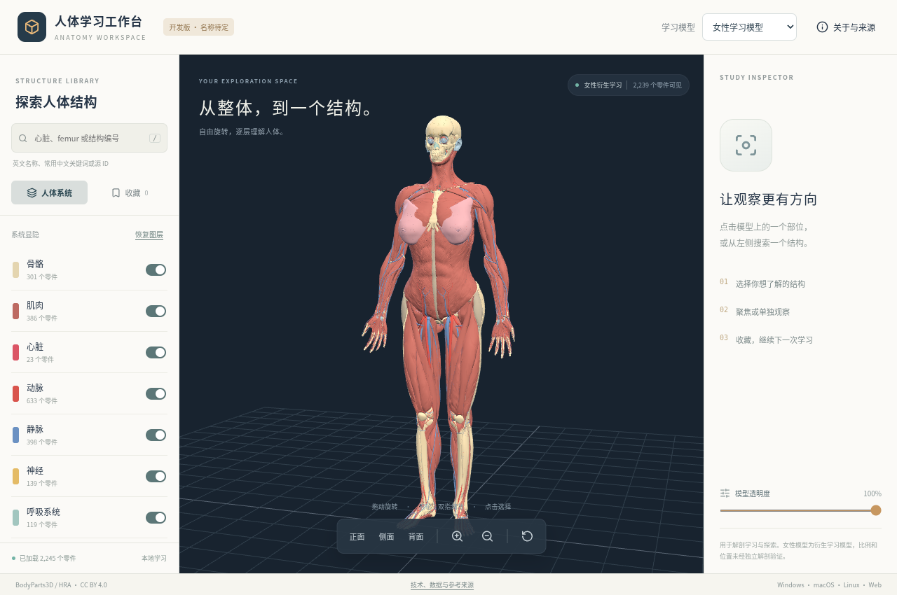
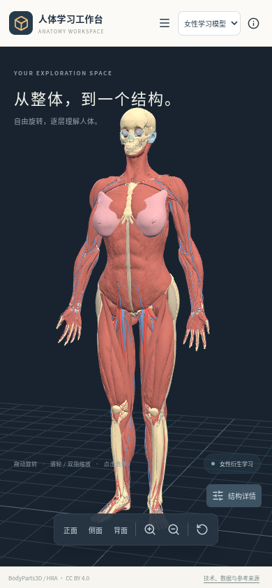

# 项目声明

这是一个**名称待定、正在独立开发的三维人体学习 App**，目标支持 Windows、macOS、Linux 和 Web。当前工作区界面、React 状态模型、结构搜索、模型加载、Three.js 场景及相机交互采用新的实现，入口为 `studio/App.tsx`。

本项目直接依赖 React、TypeScript、Three.js、Vite、Tauri、Rust、Lucide 和 fflate。层级观察、显隐和聚焦等思路参考了 [层知 / Anatolume](https://github.com/isunky/Anatolume)。仓库保留早期移植阶段的代码与构建基础，并保留其许可证和署名；不将实际继承的部分描述为仅受启发。完整来源边界见 [NOTICE.md](NOTICE.md) 和 [新工作区的实现说明](studio/PROVENANCE.md)。

模型并非本项目原创：使用 BodyParts3D、HRA / HuBMAP 与 Human Atlas Enhanced 的开放数据及现有处理产物，保留 CC BY 4.0 署名、来源与改编记录，见 [ATTRIBUTION.md](public/ATTRIBUTION.md)。

---

# 人体学习工作台（开发版，正式名称待定）

独立的三栏学习空间：左侧检索与图层，中间三维观察，右侧结构信息与收藏。小屏幕使用抽屉面板。



<details><summary>手机布局截图</summary>



</details>

截图来自新工作区的实际运行；模型数据来源与许可见上方声明。

当前提供：

- 男性参考模型 / 女性衍生学习模型切换，模型随安装包提供。
- 系统显隐、结构选择、聚焦、单独观察和隐藏所选结构。
- 英文名称、源 ID 与常用中文关键词检索；保留结构原文，不宣称全量医学术语翻译。
- 按模型保存的本地收藏；透明度、正面/侧面/背面与缩放控制。
- 切换显隐、隐藏结构和窗口尺寸变化均保留当前相机，主动“聚焦”或“重置视角”才移动相机。
- 应用内本地数据来源说明。无账号、无后台服务、无原产品自动更新通道。

## 使用与下载

[GitHub Releases](https://github.com/Eth4nMurpHy/EthanAnatomy/releases) 中以 **Workspace** 开头的开发预览属于新应用；早先以 Anatolume 命名的 Linux 预览属于旧移植阶段。新预览由 GitHub Actions 构建后上传。

Web ZIP 需要通过 HTTP/HTTPS 提供，不能直接双击 `index.html`。本地开发需要 Node.js 24：

```sh
npm ci
npm run dev
```

浏览器打开终端显示的本地地址。测试：

```sh
npm run ci:check
CHROMIUM_PATH=/usr/bin/chromium npm run test:browser
```

## 部署网页版（GitHub Pages）

仓库已包含 `Deploy workspace website` 工作流：构建静态网站，发布 GitHub Pages，并用真实浏览器检查线上模型、搜索与收藏。首次启用 Pages 需要仓库管理员完成一次设置；Actions 的默认令牌不能代替管理员开启新站点。

1. 打开 [仓库 Pages 设置](https://github.com/Eth4nMurpHy/EthanAnatomy/settings/pages)。
2. 在 **Build and deployment → Source** 中选择 **GitHub Actions**。
3. 在 Actions 中重跑 `Deploy workspace website`，或手动运行该工作流。部署成功后的真实网址会显示在运行摘要与仓库 Deployments 中。

之后修改工作区代码并推送到 `main`，工作流会自动更新网站。不需要额外服务账号、个人令牌或云环境网络修改。网页版收藏保存在当前浏览器中，不与桌面版自动同步。

## 桌面开发

安装 Rust stable 和 Tauri 2 对应平台依赖后运行 `npm run client:dev`。Linux 需要 WebKitGTK 4.1 / GTK 3；Windows 需要 MSVC / Windows SDK / WebView2；macOS 需要 Xcode Command Line Tools。

```sh
npm run client:build:linux -- -- --locked
npm run client:build:windows -- -- --locked
npm run client:build:mac -- -- --locked
```

开发版使用独立的技术标识 `io.github.eth4nmurphy.anatomyworkspace.dev` 和临时打包标签 `Anatomy Workspace Dev`，不会沿用原作者的应用标识。该标签不是已确定的正式名称。当前未接入自动更新。

## 代码结构

| 路径             | 内容                                         |
| ---------------- | -------------------------------------------- |
| `studio/`        | 新应用的界面、状态、数据读取与三维场景       |
| `tests/`         | 数据/状态测试和真实浏览器交互回归            |
| `web/`           | 新应用 Web 入口                              |
| `src-tauri/`     | 最小桌面壳与新应用标识                       |
| `public/models/` | 保留署名的模型数据资产                       |
| `public/legal/`  | 随离线应用提供的许可与来源声明               |
| `legacy/`        | 早期移植代码、脚本和文档，不由新应用入口导入 |

## 范围与限制

当前为开发中的第一版工作区，尚未覆盖教学课程、专业医学术语审校和临床用途。女性模型是估算比例与位置的衍生学习模型；实机 GPU / Wayland、Windows 和 macOS 的实际体验仍需分别验收。构建成功不能替代真实设备验证。
